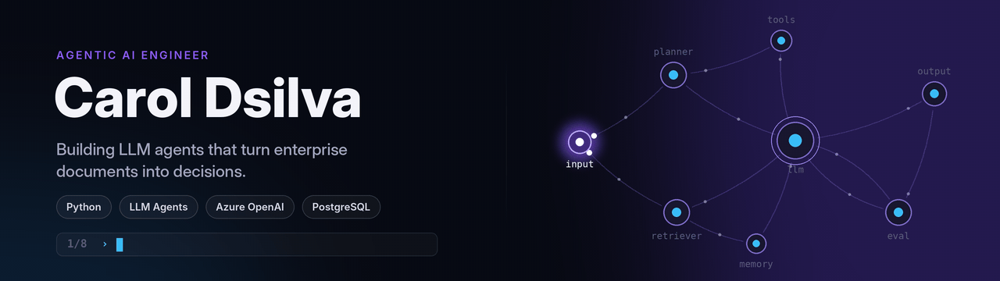

<p align="center">
  
</p>

<p align="center">
  <a href="https://caroldsilvaportfolio.web.app/"></a>
  <a href="https://linkedin.com/in/caroldsillva"></a>
  <a href="https://x.com/caroldsillva"></a>
  <a href="mailto:caroldsillva@yahoo.com"></a>
  <a href="Carol_Dsilva_Resume.pdf"></a>
</p>

<br/>

<table>
<tr>
<td width="55%" valign="top">

### About

I build **production LLM automation** at **Emplay Analytics**: agentic workflows that read enterprise procurement documents, score suppliers and validate requests before a human ever opens them.

- Agentic workflow design, prompt engineering on Azure OpenAI
- PostgreSQL pipelines and analytics behind the agents
- Exploring agent architectures and LLM evaluation

</td>
<td width="45%" valign="top">

### At a glance

```yaml
role:      Associate Agentic AI Engineer
company:   Emplay Analytics
based_in:  Bangalore, India
ar_filters: 1,000+ published · 14B+ views
workshops: 10+ led · 2,000+ students
ask_me:    agents, prompting, SQL pipelines
```

</td>
</tr>
</table>

<br/>

## Featured projects

<table>
<tr>
<td width="50%" valign="top">

#### [Email GTM Outreach Agent](https://github.com/CarolDsillva/Email_gtm_outreach_agent)
Multi-agent app that finds target companies and the right contacts, then drafts personalised B2B outreach.


</td>
<td width="50%" valign="top">

#### [Ubuntu Emoji & Clipboard](https://github.com/CarolDsillva/ubuntu-emoji-clipboard)
Windows-style <kbd>Win</kbd>+<kbd>.</kbd> emoji and clipboard-history picker for Ubuntu, with a one-line installer.


</td>
</tr>
<tr>
<td width="50%" valign="top">

#### [Indian Sign Language Detection](https://github.com/CarolDsillva/IndianSignDetection)
Real-time translation of ISL hand gestures into words from a webcam feed. 43 stars on GitHub.


</td>
<td width="50%" valign="top">

#### [emuziek](https://github.com/CarolDsillva/emuziek)
Reads your facial emotion with a CNN and recommends music to match it.


</td>
</tr>
</table>

<br/>

## Tech stack

<p align="center">
  
</p>
<p align="center"><sub>Also: Jinja2 · Zinger Agent Studio · Streamlit · MySQL · prompt engineering</sub></p>

<br/>

## Contributions

<p align="center">
  <picture>
    <source media="(prefers-color-scheme: dark)" srcset="https://raw.githubusercontent.com/CarolDsillva/CarolDsillva/output/snake-dark.svg"/>
    
  </picture>
</p>

<p align="center">
  <a href="https://www.buymeacoffee.com/caroldsilva"></a>
</p>
